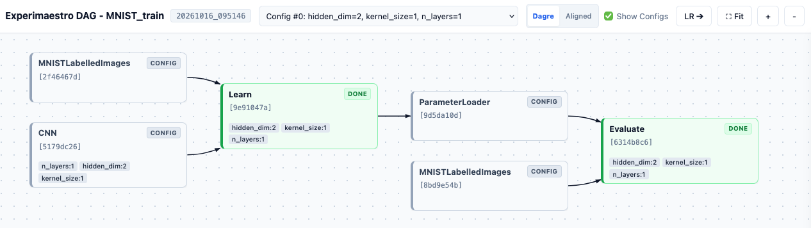

# Advanced Experimaestro Features

This guide explores the advanced capabilities of Experimaestro, building upon the basic MNIST example.

## The Advanced Experiment (`mnist_xp_advanced`)

The advanced demo (`mnist_xp_advanced/experiment.py`) demonstrates features designed for more complex research workflows.

### Declarative Grid Search

The advanced demo leverages Experimaestro's unified [`GridSearch[T]`](https://experimaestro-python.readthedocs.io/en/latest/experiments/grid_search.html) system to define and run parameter sweeps cleanly, avoiding complex nested loops. 

1. **Type Hints in the Configuration**:
   Fields representing hyperparameters use the `GridSearch[T]` type hint. This allows fields to accept single values, lists of values, or ranges in the configuration files (such as `params.yaml`).

   ```python
   from experimaestro.experiments.grid import GridSearch

   @configuration
   class Configuration(ConfigurationBase):
       n_layers: GridSearch[int] = 3
       hidden_dim: GridSearch[int] = 64
       kernel_size: GridSearch[int] = 3
   ```

2. **Generating Grid Permutations**:
   In the `run` method, calling `generate_grid(cfg)` automatically scans the configuration for search spaces, computes the Cartesian product of all combinations, and returns:
   - `configurations`: A list of copy-finalized configuration permutations (where all `GridSearch` fields are resolved to concrete scalar types like `int`).
   - `all_tags`: The list of parameter tags corresponding to each permutation.

   ```python
   from experimaestro.experiments.grid import generate_grid

   configurations, all_tags = generate_grid(cfg)
   ```

### Post-Experiment Actions

Often, you want to perform automated analysis or export artifacts once an entire experiment (including all its tasks) is complete. Experimaestro **Actions** allow you to register these workflows.

In this demo, `ExportBestModel` (defined in `mnist_xp_advanced/actions.py`) compares the accuracy of all trained models and copies the best one to a specified location.

#### Running Actions

Actions are registered during the experiment run but executed separately afterwards via the CLI or TUI:

```bash
# List available actions for an experiment
uv run experimaestro experiments actions list MNIST_train_advanced

# Run an action (omitting the action ID prompts interactively):
uv run experimaestro experiments actions run MNIST_train_advanced
```

> **Note:** If you used `--workdir` when running the experiment, place `--workdir` before `actions`:
> ```bash
> uv run experimaestro experiments --workdir ~/experiments/mnist_xp_advanced actions list MNIST_train_advanced
> ```

### Dependency Graphs (DAG) Visualization

The advanced demo showcases how tasks can depend on each other. The `Evaluate` task only runs after the `Learn` task finishes successfully. You can inspect and visualize this DAG using interactive web pages, standalone HTML reports, standardized JSON exports, terminal trees, or Matplotlib plots.



> 💡 **Side note:** *You can generate this graph yourself using `experimaestro dag` (or `uv run experimaestro dag MNIST_train_advanced`)!*

#### Visualizing the DAG with the Experimaestro CLI

```bash
# 1. Interactive Web DAG Viewer (opens in your default browser, defaults to Dagre layout)
uv run experimaestro dag MNIST_train_advanced

# 2. Launch web viewer with Aligned (stage-aligned grid) layout
uv run experimaestro dag MNIST_train_advanced --layout aligned

# 3. Export a standalone interactive HTML report (zero-server requirement)
uv run experimaestro dag MNIST_train_advanced --save-as dag.html

# 4. Export standardized JSON graph
uv run experimaestro dag MNIST_train_advanced --save-as dag.json

# 5. List all distinct configurations found in the experiment run
uv run experimaestro dag MNIST_train_advanced --list-configs

# 6. View only a specific configuration by index (e.g. config [0])
uv run experimaestro dag MNIST_train_advanced -c 0

# 7. Filter configurations by hyperparameters (e.g. lr=0.001 and kernel_size=3)
uv run experimaestro dag MNIST_train_advanced --filter "lr=0.001,kernel_size=3"

# 8. Include downstream action candidates (EvaluatedModel / ExportBestModel) for that configuration
uv run experimaestro dag MNIST_train_advanced -c 0 --include-actions

# 9. Print terminal ASCII tree
uv run experimaestro dag MNIST_train_advanced --tree

# 10. Matplotlib interactive plot or export to image
uv run experimaestro dag MNIST_train_advanced --plot
uv run experimaestro dag MNIST_train_advanced --save-as dag.png
```


## Running the Advanced Demo

1.  **Run the experiment:**
    ```bash
    uv run experimaestro run-experiment mnist_xp_advanced/params.yaml
    ```
    *(Or specify `--workdir ~/experiments/mnist_xp_advanced` if not using global workspace triggers).*

2.  **Inspect results:**
    ```bash
    uv run python -m mnist_xp_advanced.analyze
    ```

3.  **Run the post-experiment action:**
    Once all tasks are finished, run the interactive action prompt to export the best model:
    ```bash
    uv run experimaestro experiments actions run MNIST_train_advanced
    ```
